# Game SIGINT


**Simulasi signals intelligence (SIGINT) bernuansa 8-bit, dalam satu file `.exe`.**
Dibuat oleh **Octacons / YD1RUH**.

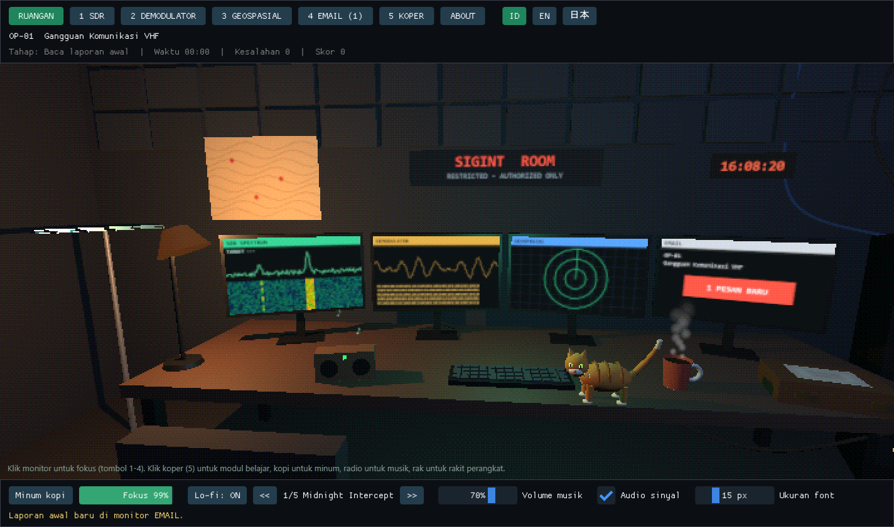

## Deskripsi

Kamu adalah operator di ruang SIGINT. Ada empat monitor, secangkir kopi, musik lo-fi,
dan seekor kucing yang sesekali lewat di meja. Laporan masuk: radio pelabuhan terganggu,
BTS palsu muncul, kapal tersesat karena GPS spoofing, atau satelit pengintai melintas.

Tugasmu: baca laporan, rakit rantai RF (SDR, antena, kabel, LNA), sweep spektrum,
identifikasi dan demodulasi sinyal, pecahkan sandi, cari lokasi pemancar, lalu kirim
laporan ke atasan. Setiap percobaan diacak, jadi jawabannya tidak bisa dihafal.

*In English:* a single-exe SIGINT simulation. Build the receive chain, hunt signals,
break classic ciphers, run direction finding and track satellites. The interface is
available in Indonesian, English and Japanese.

> Semua operasi, lembaga, satelit, dan data di game ini **fiktif** dan dibuat untuk
> pembelajaran. Menyadap komunikasi tanpa izin adalah pelanggaran hukum.

## Cuplikan

| Briefing intelijen | Rakit perangkat dan routing |
| --- | --- |
| 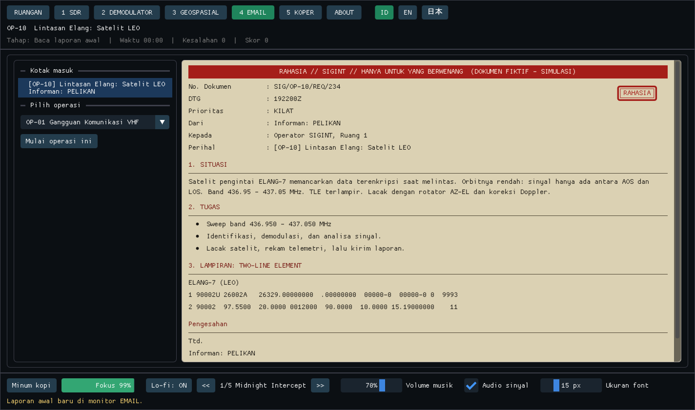 | 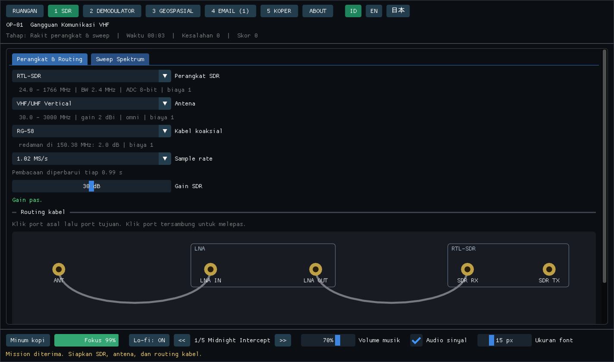 |
| **Sweep spektrum** | **Demodulator (FFT dan filter)** |
| 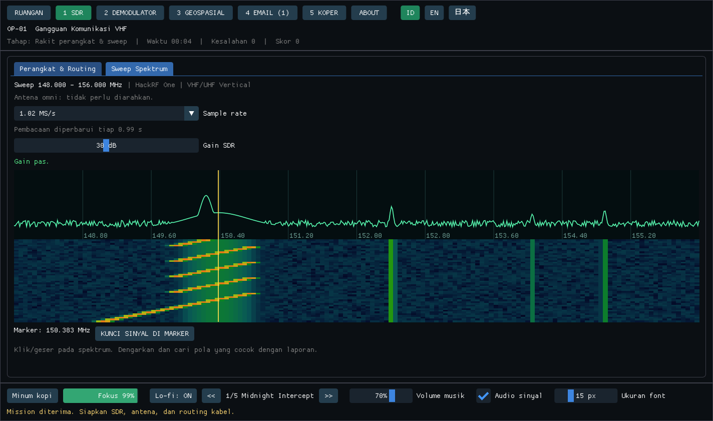 | 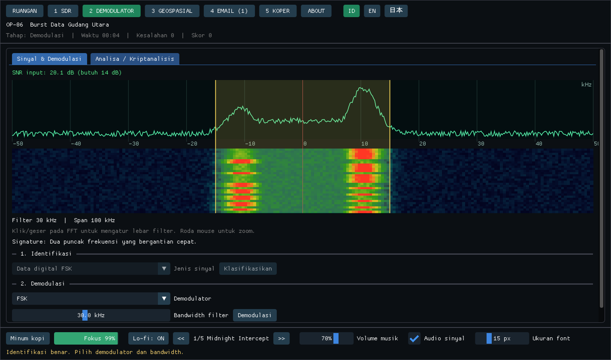 |
| **Kriptanalisis** | **Direction finding** |
| 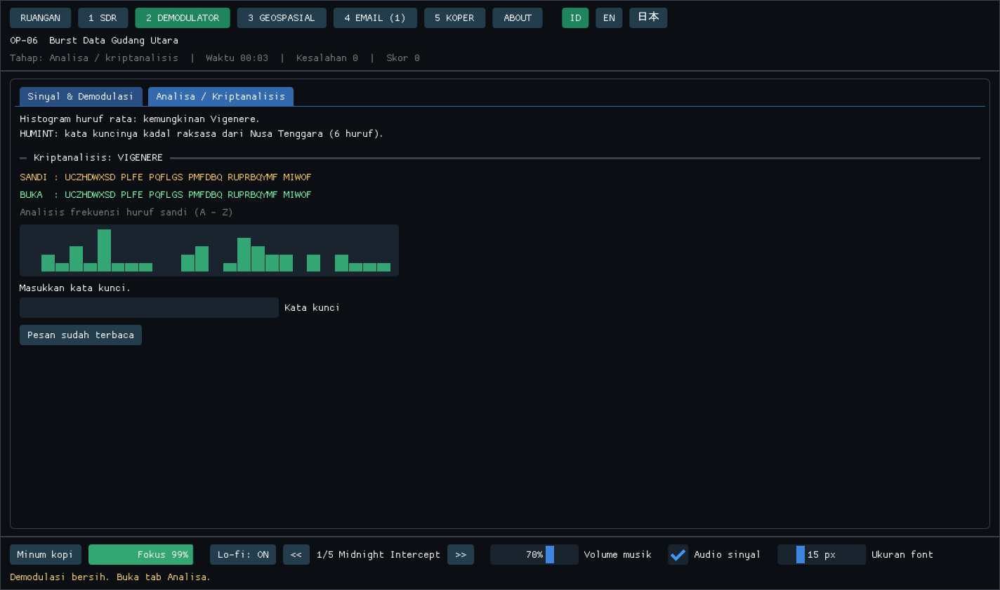 | 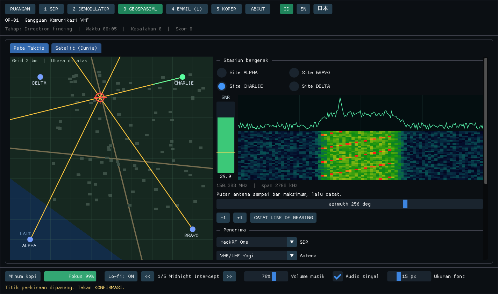 |
| **Tracking satelit** | **Laporan ke atasan** |
| 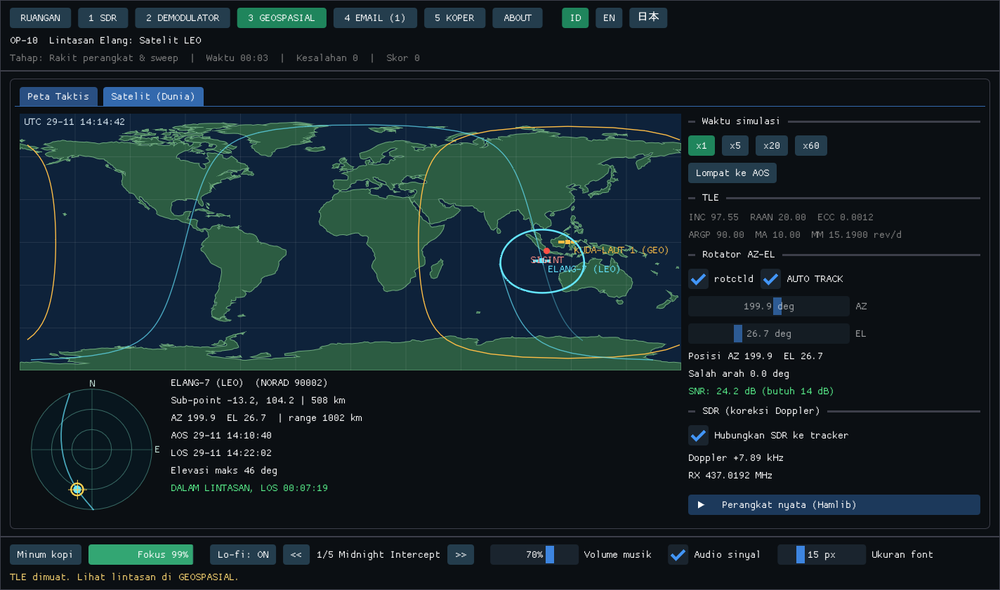 | 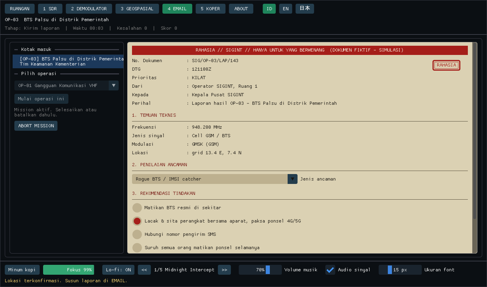 |
| **Koper modul belajar (日本語)** | **About** |
| 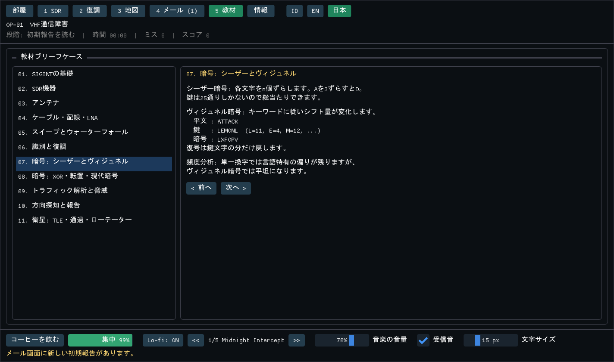 | 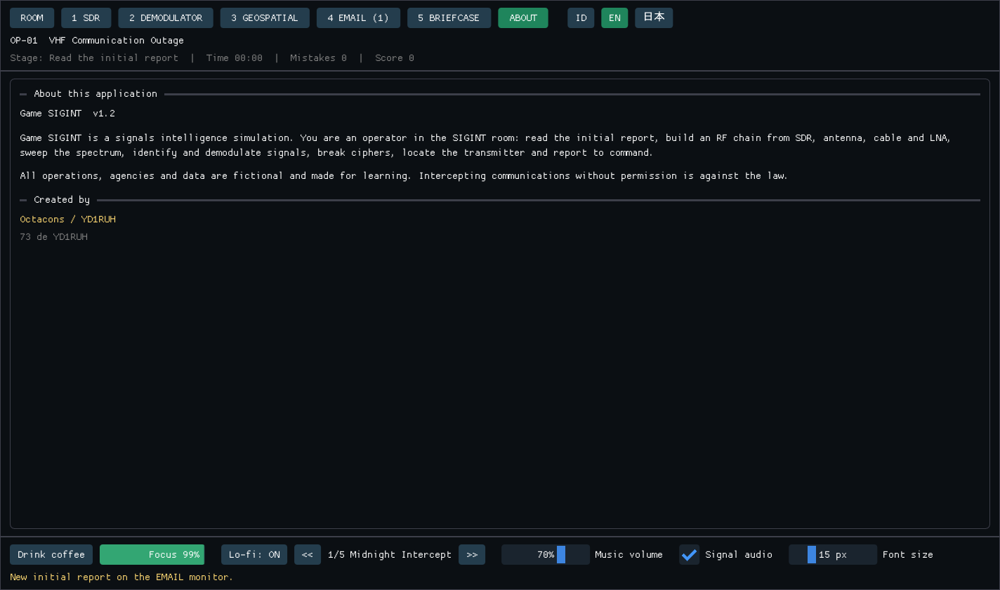 |

## Fitur

- Ruangan 3D bergaya piksel dengan empat monitor yang bisa difokuskan.
- 7 SDR, 8 antena, 4 jenis kabel, LNA, gain, dan sample rate.
- FFT dan waterfall dengan filter yang diatur langsung di layar.
- Kriptanalisis: Caesar, Vigenere, XOR, rail fence berlapis.
- Direction finding dengan Line of Bearing.
- Satelit GEO dan LEO: TLE, peta dunia, footprint, AOS/LOS, rotator AZ-EL, Doppler.
- Koneksi opsional ke `rotctld` dan `rigctld` (Hamlib).
- 11 modul belajar singkat di dalam koper.
- Audio sinyal sintesis dan 5 lagu lo-fi.
- Bahasa Indonesia, Inggris, dan Jepang. Ukuran font bisa diatur.

## Unduh dan jalankan

1. Ambil `SIGINT-v1.2-win64.zip` dari halaman [Releases](../../releases).
2. Ekstrak, lalu jalankan `SIGINT.exe`.

Kebutuhan:

- Windows 10 atau 11, 64-bit.
- Microsoft Edge WebView2 Runtime (sudah ada di Windows 11).
- Teks Jepang memakai font bawaan Windows (MS Gothic, Yu Gothic, atau Meiryo).

Exe belum ditandatangani secara digital, sehingga Windows SmartScreen dapat menampilkan
peringatan. Saat pertama jalan, game menulis `WebView2Loader.dll` dan cache ke
`%LOCALAPPDATA%\SigintGame`. Progres tidak disimpan.

## Cara main

| Tombol / klik | Fungsi |
| --- | --- |
| `1` `2` `3` `4` atau klik monitor | SDR, Demodulator, Geospasial, Email |
| `5` atau klik koper | Modul pembelajaran |
| `Esc` | Kembali ke ruangan |
| `ID` `EN` `日本` | Ganti bahasa |
| Klik kopi / "Minum kopi" | Pulihkan fokus |
| Klik radio / "Lo-fi", `<<` `>>` | Musik nyala/mati, ganti lagu |
| "Volume musik", "Ukuran font" | Pengaturan suara dan tampilan |
| Klik rak SDR | Rakit perangkat |
| Klik kucing | Elus kucing |
| Klik/geser pada FFT demodulator | Atur lebar filter; roda mouse untuk zoom |
| "Gain SDR", "Sample rate" | Gain memengaruhi SNR; sample rate memengaruhi laju pembaruan |
| "Abort mission" (Email) | Batalkan mission aktif |

Alur tiap mission: baca laporan (Email), rakit perangkat (SDR), sweep dan kunci sinyal,
identifikasi, demodulasi, analisa atau kriptanalisis (Demodulator), direction finding
(Geospasial), kirim laporan (Email). Operasi bisa dipilih dari panel "Pilih operasi".

## Mission

| Kode | Target | Analisa |
| --- | --- | --- |
| OP-01 | Jammer VHF | Jenis jammer |
| OP-02 | Siaran huruf HF | Caesar |
| OP-03 | Rogue BTS | Traffic analysis |
| OP-04 | GPS spoofing | Bukti spoofing |
| OP-05 | Radar X-band | Pustaka ELINT |
| OP-06 | Burst data FSK | Vigenere |
| OP-07 | Telemetri drone | XOR, known plaintext |
| OP-08 | Morse HF | Rail fence + Caesar |
| OP-09 | Satelit GEO, L-band | Transponder tanpa izin |
| OP-10 | Satelit LEO, 437 MHz | Vigenere |

### Mission satelit

1. Terima mission, lalu "Muat TLE ke tracker" di email.
2. Rakit perangkat. GEO butuh dish; LEO cukup Yagi atau dipole dengan LNA.
3. Geospasial, tab Satelit: centang `rotctld` lalu `AUTO TRACK`, atau atur AZ-EL manual.
4. Hubungkan SDR ke tracker untuk koreksi Doppler.
5. LEO: sinyal hanya ada antara AOS dan LOS. Pakai "Lompat ke AOS" atau percepat waktu.
6. Setelah analisa, rekam telemetri 90 detik, lalu kirim laporan.

Orbit dihitung dengan model sederhana (Kepler + J2), bukan SGP4. Stasiun bumi ada di
-6.20, 106.82.

## Perangkat nyata (opsional)

Panel "Perangkat nyata (Hamlib)" dapat menyambung ke `rotctld` (port 4533) dan `rigctld`
atau remote control SDR++ / gqrx.

- Tidak ada koneksi sebelum menekan "Sambungkan".
- Rotator hanya bergerak bila "Izinkan rotator fisik bergerak" dicentang dan waktu x1.
- Saat putus, game mengirim perintah stop (`S`).
- SDR hanya diatur frekuensinya; game tidak membaca sinyal dari SDR nyata.

**Peringatan:** fitur ini baru diuji terhadap server tiruan, belum terhadap perangkat
sungguhan. Pastikan area antena aman sebelum mengizinkan rotator bergerak.

## Build dari sumber

Kebutuhan: [MSYS2](https://www.msys2.org/) dengan paket `mingw-w64-ucrt-x86_64-gcc`,
`git`, dan PowerShell.

```powershell
powershell -ExecutionPolicy Bypass -File .\build.ps1      # hasil: dist\SIGINT.exe
powershell -ExecutionPolicy Bypass -File .\package.ps1    # hasil: dist\SIGINT-v1.2-win64.zip
```

Bila MSYS2 tidak di `C:\msys64`, tambahkan `-Mingw <path>\ucrt64\bin`. Build mengunduh
Dear ImGui, WebView2 SDK, dan Three.js, menjalankan test, lalu menautkan semuanya.

## Struktur

| File | Isi |
| --- | --- |
| `src/main.cpp` | Jendela Win32, Direct3D 11, host WebView2 |
| `src/ui.h`, `src/ui_sat.h` | Layar Dear ImGui |
| `src/game.h` | Aturan game |
| `src/missions.h`, `src/variant.h` | Data mission dan pengacakan |
| `src/crypto.h`, `src/orbit.h` | Sandi klasik dan orbit satelit |
| `src/net.h` | Klien Hamlib opsional |
| `src/content.h` | Modul belajar dan teks About |
| `web/room.html` | Ruangan 3D, audio, musik |
| `tests/test_game.cpp` | Memastikan semua mission bisa diselesaikan |

## Kredit dan lisensi

Game dibuat oleh **Octacons / YD1RUH**. Hak cipta 2026.

Pustaka pihak ketiga (Dear ImGui, Three.js, WebView2 SDK, font ProggyClean, runtime
MinGW-w64) dan data peta Natural Earth tercantum di
[THIRD_PARTY_NOTICES.txt](THIRD_PARTY_NOTICES.txt).

73 de YD1RUH
