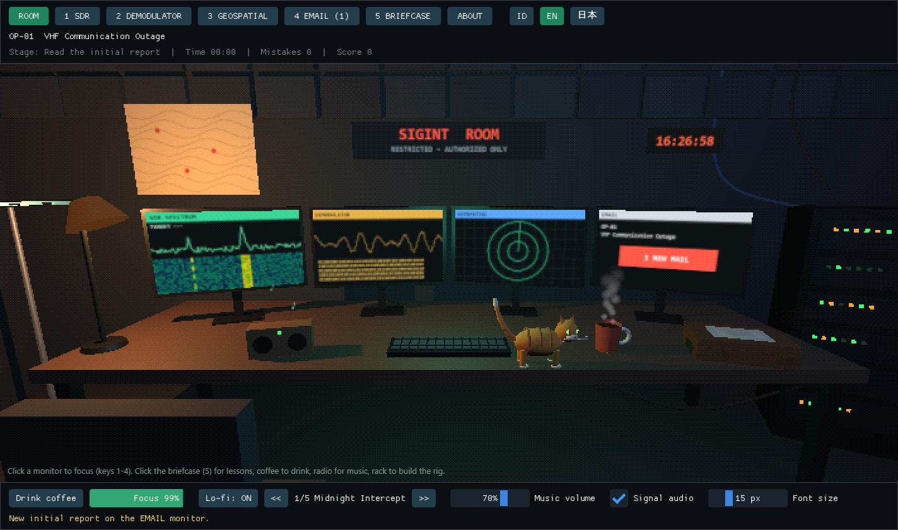
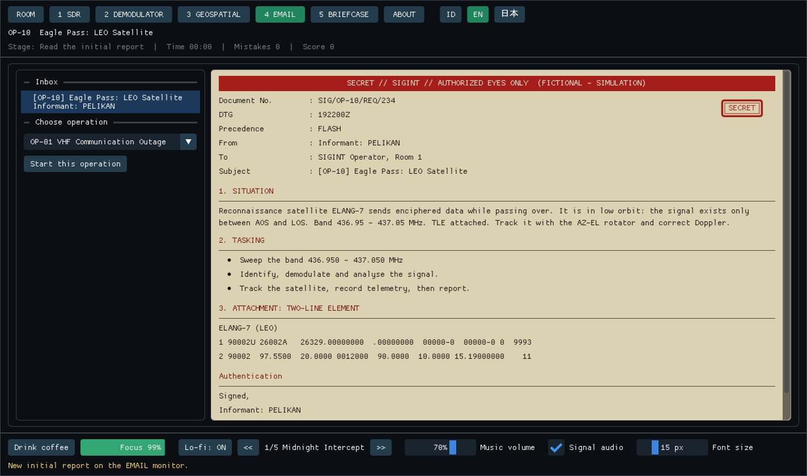
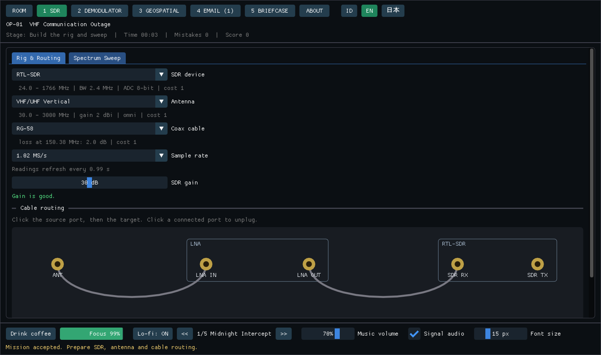
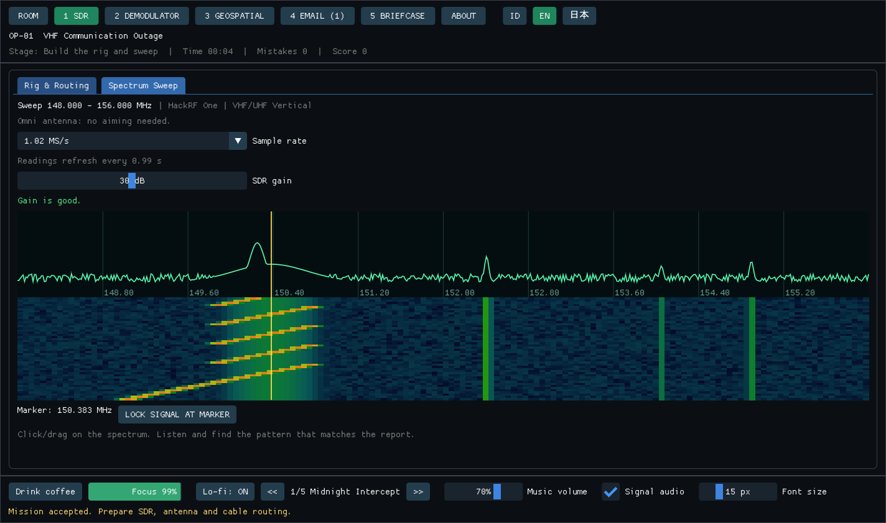
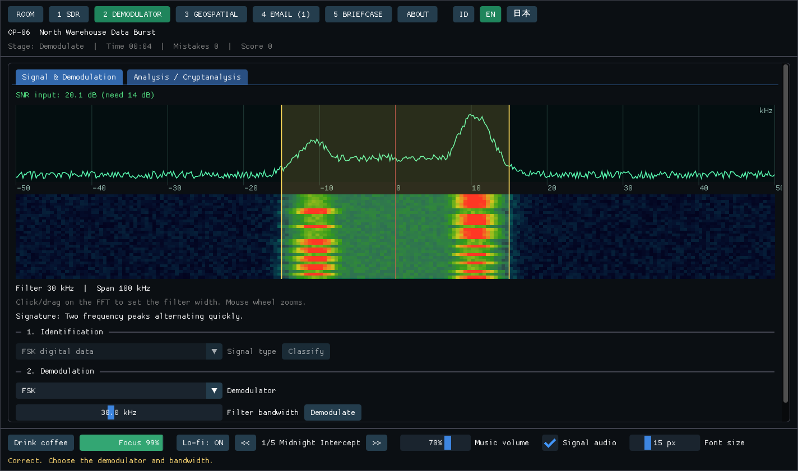
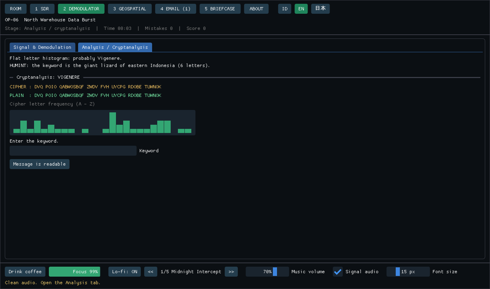
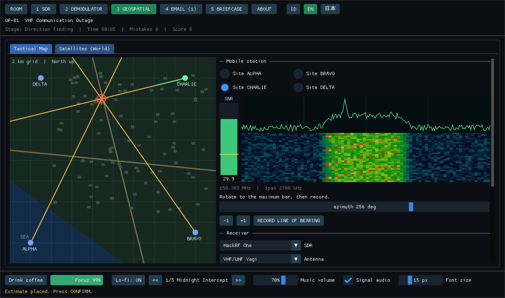
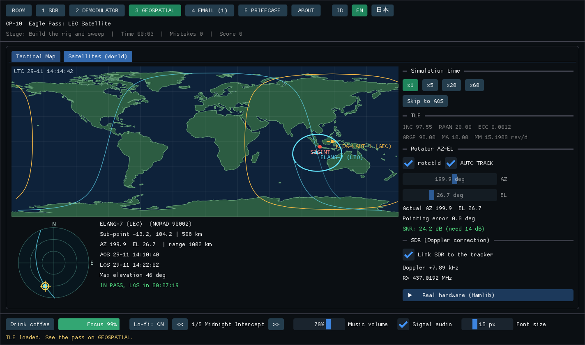
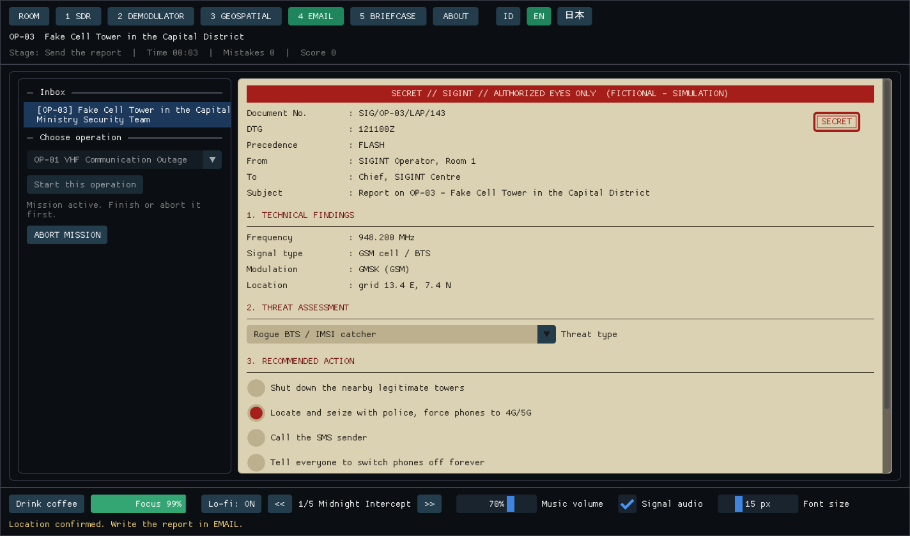

# Game SIGINT

**An 8-bit flavoured signals intelligence (SIGINT) simulation in a single `.exe`.**
Created by **Octacons / YD1RUH**.

## About the game

You are the operator in the SIGINT room: four monitors, a cup of coffee, lo-fi music and
a cat that now and then walks across the desk. Then the reports arrive. Harbour radios are
jammed, a fake cell tower appears, ships get lost to GPS spoofing, a reconnaissance
satellite passes overhead.

Read the briefing, build the RF chain (SDR, antenna, cable, LNA), sweep the spectrum,
identify and demodulate the signal, break the cipher, locate the transmitter and report to
command. Every attempt is randomised, so answers cannot be memorised.

> All operations, agencies, satellites and data in this game are **fictional** and made for
> learning. Intercepting communications without permission is against the law.

## Features

- Pixel-styled 3D room with four monitors you can focus on.
- 7 SDRs, 8 antennas, 4 cable types, LNA, gain and sample rate.
- Spectrum and waterfall with a filter you drag on screen.
- Cryptanalysis: Caesar, Vigenere, XOR and layered rail fence.
- Direction finding with lines of bearing.
- GEO and LEO satellites: TLE, world map, footprint, AOS/LOS, AZ-EL rotator, Doppler.
- Optional connection to `rotctld` and `rigctld` (Hamlib).
- A briefcase with 11 short training modules.
- Signal audio and 5 lo-fi tracks.
- English, Indonesian and Japanese, with adjustable font size.

## Screenshots

| Intelligence briefing | Rig building and routing |
| --- | --- |
|  |  |
| **Spectrum sweep** | **Demodulator** |
|  |  |
| **Cryptanalysis** | **Direction finding** |
|  |  |
| **Satellite tracking** | **Report to command** |
|  |  |
| **Training briefcase (Japanese)** | **About** |
|  |  |

## Download and play

1. Download [SIGINT-v1.2-win64.zip](SIGINT-v1.2-win64.zip) (open the file, then press **Download raw file**).
2. Extract it and run `SIGINT.exe`.

Requirements:

- 64-bit Windows 10 or 11.
- Microsoft Edge WebView2 Runtime (included in Windows 11).
- Japanese text uses a Japanese font that ships with Windows.

The executable is not code-signed, so Windows SmartScreen may show a warning. On first run
the game writes a helper file and its cache to `%LOCALAPPDATA%\SigintGame`. Progress is not
saved.

## Controls

| Key / click | Action |
| --- | --- |
| `1` `2` `3` `4` or click a monitor | SDR, Demodulator, Geospatial, Email |
| `5` or click the briefcase | Training modules |
| `Esc` | Back to the room |
| `ID` `EN` `日本` | Change language |
| Click the coffee / "Drink coffee" | Restore focus |
| Click the radio / "Lo-fi", `<<` `>>` | Music on or off, change track |
| "Music volume", "Font size" | Sound and display settings |
| Click the SDR rack | Build the rig |
| Click the cat | Pet the cat |
| Click or drag on the demodulator FFT | Set the filter width; mouse wheel zooms |
| "SDR gain", "Sample rate" | Gain affects SNR; sample rate sets how fast readings refresh |
| "Abort mission" (Email) | Cancel the active mission |

Mission flow: read the report (Email), build the rig (SDR), sweep and lock the signal,
identify, demodulate, analyse or decrypt (Demodulator), find the direction (Geospatial) and
send the report (Email). Pick any operation under "Choose operation".

## Operations

| Code | Target | Analysis |
| --- | --- | --- |
| OP-01 | VHF jammer | Jammer type |
| OP-02 | HF letter broadcast | Caesar |
| OP-03 | Rogue BTS | Traffic analysis |
| OP-04 | GPS spoofing | Proof of spoofing |
| OP-05 | X-band radar | ELINT library |
| OP-06 | FSK data burst | Vigenere |
| OP-07 | Drone telemetry | XOR with known plaintext |
| OP-08 | HF Morse | Rail fence and Caesar |
| OP-09 | GEO satellite, L-band | Unauthorised transponder use |
| OP-10 | LEO satellite, 437 MHz | Vigenere |

### Satellite missions

1. Accept the mission, then press "Load TLE into tracker" in the e-mail.
2. Build the rig. GEO needs a dish; LEO works with a Yagi or dipole plus LNA.
3. On Geospatial, Satellites tab: tick `rotctld` and `AUTO TRACK`, or set AZ and EL by hand.
4. Link the SDR to the tracker for Doppler correction.
5. LEO: the signal exists only between AOS and LOS. Use "Skip to AOS" or speed up time.
6. After the analysis, record 90 seconds of telemetry and send the report.

Orbits use a simplified model and are not suitable for tracking real satellites.

## Real hardware (optional)

The "Real hardware (Hamlib)" panel can connect to `rotctld` (port 4533) and `rigctld`, or to
SDR++ / gqrx remote control.

- Nothing connects until you press "Connect".
- The rotator moves only when "Allow the physical rotator to move" is ticked and time is x1.
- On disconnect the game sends a stop command.
- The SDR is only tuned; the game does not read signals from a real receiver.

**Warning:** this feature has been tested against a simulated server only, not against real
hardware. Make sure the antenna area is clear before allowing the rotator to move.

## Credits

Game by **Octacons / YD1RUH**. Copyright 2026. 

73 de YD1RUH
